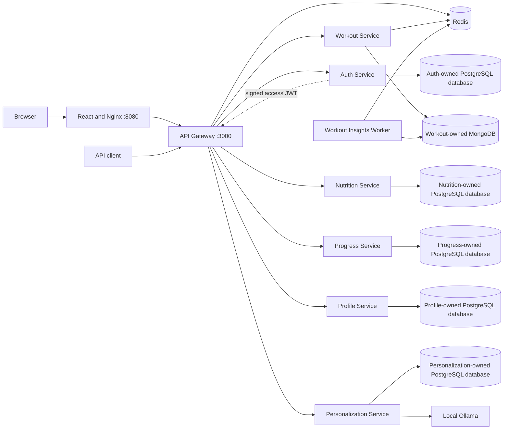

# FITFORGE

[](https://github.com/Shashank520104/FITFORGE/actions/workflows/ci.yml)
[](https://nodejs.org/)
[](https://www.typescriptlang.org/)
[](https://react.dev/)
[](https://www.docker.com/)
[](https://opensource.org/licenses/MIT)

FITFORGE is an enterprise-grade fitness and nutrition intelligence platform built with a distributed microservices architecture. It features an API Gateway, independently runnable and containerized authentication, workout, nutrition, progress, profile, and personalization services, alongside a responsive React 19 web application with interactive D3 data visualizations.

## Current architecture



Auth owns account credentials and refresh sessions. Workout owns the exercise catalogue, owner-scoped plans, and workout sessions. Nutrition owns user-entered custom foods and meal logs. Progress owns user-entered body measurements and strength records. Profile owns private user preferences and does not duplicate Auth account data. Personalization owns wellness preferences, encrypted user-uploaded reports, and saved general meal and movement ideas; report text is processed only on explicit request and is never used to generate plans. Workout ideas remain hidden until the user confirms clinician clearance. This feature is not a medical service and does not diagnose, assess exercise safety, or prescribe recovery. Redis provides shared gateway rate limits, short-lived exercise/insight caches, and the BullMQ queue for workout-insight refresh jobs. The worker reads MongoDB-owned workout data and caches owner-scoped descriptive results. The services verify access tokens and access only their own databases. Food estimates and wellness suggestions use a local Ollama model (`qwen2.5:3b` by default); the user reviews food estimates before saving. Estimates are labeled and stored with protein, carbohydrates, fat, fiber, sodium, calcium, iron, potassium, and magnesium per 100 g/ml. Ollama downloads the model once into a persistent Docker volume and runs locally without a paid API key. No curated Indian food catalogue has been shipped.

## Run locally

Prerequisites: Docker Desktop with Docker Compose, and Node.js 22+ with npm.

```powershell
Copy-Item .env.example .env
```

Set unique local values for all database passwords and `JWT_SECRET`. Generate a separate report-encryption key without printing or committing it:

```powershell
$keyBytes = New-Object byte[] 32
[System.Security.Cryptography.RandomNumberGenerator]::Create().GetBytes($keyBytes)
$key = [Convert]::ToBase64String($keyBytes).TrimEnd('=').Replace('+', '-').Replace('/', '_')
$envText = Get-Content .env -Raw
$envText = [regex]::Replace($envText, '(?m)^REPORT_ENCRYPTION_KEY=.*$', "REPORT_ENCRYPTION_KEY=$key")
[System.IO.File]::WriteAllText((Resolve-Path .env), $envText)
Remove-Variable key, keyBytes, envText
```

Keep `REPORT_ENCRYPTION_KEY` backed up securely and separate from the database; changing or losing it makes existing uploaded reports unreadable. The `.env` file is local configuration and must never be committed. Food estimates and wellness suggestions use local Ollama with `qwen2.5:3b` by default; Compose downloads the model on first startup. Override `OLLAMA_MODEL` in `.env` to select another Ollama model. The first model download requires an internet connection and several GB of disk; AI requests then run on this computer without paid API credits. Compose builds a local PostgreSQL cluster and initializes distinct Auth/Nutrition/Progress/Profile/Personalization databases and roles, plus MongoDB for Workout, Redis for shared limits/caching/jobs, and Ollama for local AI. PostgreSQL binds to `127.0.0.1:5432` by default; set `POSTGRES_PORT` in `.env` if that host port is unavailable. The bootstrap scripts run only when the PostgreSQL data volume is first created.

```powershell
docker compose up --build -d
docker compose ps
docker compose logs -f api-gateway auth-service workout-service workout-jobs-worker nutrition-service progress-service profile-service personalization-service redis
Invoke-RestMethod http://localhost:3000/health
Invoke-RestMethod http://localhost:3000/ready
```

The web app is available at `http://localhost:8080`, the API Gateway at `http://localhost:3000`, and interactive Swagger UI at `http://localhost:3000/docs/`. Local databases bind to loopback for explicit test access; Redis is internal to the Compose network. To stop while preserving data: `docker compose down`. To deliberately remove local database data, inspect the Compose project and use `docker compose down --volumes` only when the data is disposable.

Use the web app to register/sign in and manage plans, exercise discovery, workout sessions, food entries, meal logs, progress records, profile preferences, and the Wellness page. The Wellness page supports encrypted, user-controlled report storage and optional local-model summaries, alongside personalized seven-day everyday food and (after explicit clinician-clearance confirmation) general movement ideas. It does not provide medical advice, and report text is not used for plan generation. Read [the Personalization Service notes](./services/personalization-service/README.md) before enabling report uploads. The app retains the refresh token only in an HttpOnly cookie and holds short-lived access tokens in memory. `GET /api/v1/exercises` is public.

## Development checks

Each service and the frontend have a separate dependency manifest and lockfile. Install from the root with:

```powershell
npm ci
Get-ChildItem .\services -Directory | ForEach-Object { npm ci --prefix $_.FullName }
npm ci --prefix frontend
npm run lint
npm run format:check
npm run build
npm test
```

The unit/API suites run without databases. Explicit isolated database variables enable Auth, Workout, Nutrition, Progress, Profile, and Personalization integration tests; see each service README. CI runs builds/unit tests, database integration tests, and image builds.

## Implemented boundaries

| Service                 | Data ownership                               | Current behavior                                                                                                                                                                 |
| ----------------------- | -------------------------------------------- | -------------------------------------------------------------------------------------------------------------------------------------------------------------------------------- |
| API Gateway             | Routing / HTTP cross-cutting                 | Request IDs, service routing, JWT checks, bounded proxy timeout/body size, Redis-backed shared rate limit, interactive Swagger UI                                                |
| Auth Service            | Auth PostgreSQL database                     | Registration/login, bcrypt, signed short-lived JWT, refresh rotation/logout                                                                                                      |
| Workout Service         | MongoDB `fitforge_workout`                   | Exercise discovery, owner-scoped plans, workout execution/history, Redis-cached catalogue, and descriptive progression insights                                                  |
| Workout Jobs Worker     | MongoDB `fitforge_workout` / Redis           | BullMQ worker refreshes owner-scoped workout insights asynchronously after session completion                                                                                    |
| Nutrition Service       | Separate Nutrition PostgreSQL database       | Owner-scoped custom foods, meal logs, immutable nutrient snapshots and calculated totals                                                                                         |
| Progress Service        | Separate Progress PostgreSQL database        | Owner-scoped body measurements, strength history, max-load personal records, and manual daily activity and sleep logs                                                            |
| Profile Service         | Separate Profile PostgreSQL database         | Private user preferences for units, goals, experience, equipment, and dietary labels                                                                                             |
| Personalization Service | Separate Personalization PostgreSQL database | Encrypted owner-scoped report storage, user-requested non-diagnostic summaries, personalized general meal ideas, and explicit clinician-clearance gating for workouts            |
| Web App                 | Browser / Nginx                              | Responsive auth, exercise catalogue, plan management, workout execution/history, sourced food logging, manual activity/sleep tracking, D3 progress charts, and the Wellness page |

API specifications and current implementation notes live in each service folder and [docs](./docs/).

## Remaining product scope

Not yet implemented: curated/licensed Indian foods and substitutions; evaluated nutrition RAG/Qdrant; deployment, backups, tracing, Prometheus/Grafana, and a production security review. RabbitMQ/Kafka and Kubernetes remain optional scale-up choices. Training insights compare actual logged volume only and are descriptive, not prescriptive.

The Figma-ready visual-system specification is [here](./docs/design/figma-ready-spec.md); no Figma file was created. Compose startup and DB-backed integration tests have been exercised locally, but do not establish production readiness. If host port `5432` is unavailable, choose a free local `POSTGRES_PORT` in `.env`.
