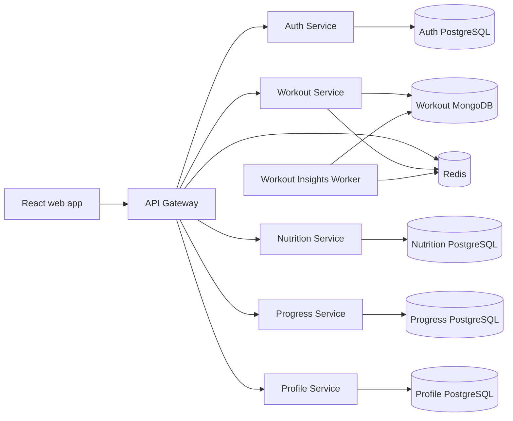

# FITFORGE Backend Implementation Report

**Purpose:** Evaluation-ready overview of the backend implementation, database schema, project structure, and microservice boundaries.

## 1. Project overview

FITFORGE is a fitness and nutrition application implemented as independently runnable services behind an API Gateway. The backend supports authentication, workout planning and tracking, custom food and meal logging, progress records, and user preferences. The React web app uses the Gateway as its API entry point.

The service boundaries are implemented in code and configured for local development with Docker Compose. This is a working development implementation, not a claim of production deployment or production readiness.

## 2. Architecture and request flow



1. The browser sends API requests to the Gateway.
2. The Gateway assigns a request ID, applies shared rate limiting, checks access tokens on protected routes, and forwards requests to the owning service.
3. Each domain service verifies the access token itself and scopes user data to its subject. The Gateway is not the sole authorization boundary.
4. A service reads and writes only its own database. Cross-service user IDs are ownership keys, not database joins or foreign keys.
5. Completing a workout can enqueue an insights refresh for the separate worker through Redis/BullMQ.

## 3. Microservices and responsibilities

| Component | Responsibility | Main technology and data |
|---|---|---|
| API Gateway | Public API entry point, routing, request IDs/logging, token checks, bounded proxying, shared rate limiting, API documentation | Express, TypeScript, Redis, OpenAPI/Swagger |
| Auth Service | Registration, login, password verification, access tokens, refresh rotation/logout, current-account endpoint | Express, TypeScript, PostgreSQL, bcrypt, JWT |
| Workout Service | Public exercise catalogue; authenticated plans, sessions, set logging, history, and descriptive progression insights | Express, TypeScript, MongoDB/Mongoose, Redis |
| Workout Insights Worker | Asynchronous refresh of owner-scoped workout insight cache entries | BullMQ, Redis, MongoDB |
| Nutrition Service | User-owned custom foods, meal logs, nutrient totals, and immutable item snapshots | Express, TypeScript, dedicated PostgreSQL database |
| Progress Service | Body measurements, strength logs, max-load personal records, and summary endpoints | Express, TypeScript, dedicated PostgreSQL database |
| Profile Service | User preferences for units, training goals, experience, equipment, and dietary labels | Express, TypeScript, dedicated PostgreSQL database |
| Web App | Registration/sign-in and user flows for workouts, nutrition, progress, and profile | React, TypeScript, Vite |
| Redis | Shared Gateway rate-limit windows, Workout cache, and background job queue | Redis |

Services have separate package manifests, build/test scripts, API contracts, and Docker build contexts under [`services/`](../services/). The older [`backend/`](../backend/) directory is the legacy monolithic implementation retained during migration; the independent services are the active microservice structure.

## 4. Database design and ownership

Compose provisions one PostgreSQL server with separate databases and owner roles for Auth, Nutrition, Progress, and Profile. Workout uses a separate MongoDB database named `fitforge_workout`. SQL changes are versioned in each PostgreSQL service's `migrations/` directory and run by that service's migration command.

### Auth PostgreSQL

| Table | Important fields and constraints | Purpose |
|---|---|---|
| `users` | UUID primary key, unique email, password hash, creation/update timestamps | Account identity and credential storage |
| `refresh_sessions` | UUID primary key, user foreign key with cascade delete, unique token digest, expiry/revocation timestamps; indexes for user and active sessions | Refresh-token rotation and revocation |

Passwords are stored as bcrypt hashes. Refresh tokens are opaque values; only their SHA-256 digests are persisted.

### Workout MongoDB

| Collection | Main data | Important design |
|---|---|---|
| `exercises` | Name, muscle groups, equipment, difficulty, movement type, description, optional media URLs | Mongoose validation and indexes support catalogue filters |
| `workoutplans` | Owner ID, name, goal, embedded days, planned exercises and sets | Bounded aggregate; planned exercises reference catalogue IDs; owner/update index |
| `workoutsessions` | Owner, source plan metadata, selected-day snapshot, planned and actual set data, status, timestamps | History survives plan changes; owner/start index; partial unique index allows at most one active session per owner |

Plans are limited to seven days, twelve exercises per day, and ten sets per exercise. API validation constrains reps, load, and rest time. Session documents snapshot plan and exercise details so later edits do not rewrite history.

### Nutrition PostgreSQL

| Table | Important fields and constraints | Purpose |
|---|---|---|
| `foods` | Owner ID, name/brand, g/ml serving unit, nutrient values per 100 units, source label/URL | Caller-entered foods with source attribution; owner/name index |
| `meal_logs` | Owner ID, date, meal type | Dated owner-scoped meal records; owner/date index |
| `meal_log_items` | Log ID, food ID, food/nutrient/source snapshots, serving amount | Preserves historical values if a food is later changed or deleted |

Meal creation snapshots the selected food values transactionally. Nutrition values are user-provided; the service does not claim a verified shared food catalogue.

### Progress PostgreSQL

| Table | Important fields and constraints | Purpose |
|---|---|---|
| `body_measurements` | Owner ID, date, weight, optional body-fat percentage/note; unique owner/date | Measurement history and date-based lookup |
| `strength_records` | Owner ID, exercise name/optional ID, date, load, reps, optional note | Strength history and max-load personal-record calculation |

### Profile PostgreSQL

| Table | Important fields and constraints | Purpose |
|---|---|---|
| `user_profiles` | Owner ID primary key, display name, units, training goal, experience, equipment and dietary-preference arrays | Private preferences with enum and array-size/value constraints |

### Consistency and privacy

The Auth user ID is the external owner key in other domains. Domain databases do not contain cross-service foreign keys or copies of account credentials. Queries filter by the verified owner ID. Nutrition history uses value snapshots; workout history uses plan/day/exercise snapshots.

## 5. Repository structure

```text
FITFORGE/
├── services/
│   ├── api-gateway/       # Routes, cross-cutting HTTP policy, OpenAPI
│   ├── auth-service/      # Auth API, SQL migration, tests
│   ├── workout-service/   # Workout API, MongoDB models, worker/queue
│   ├── nutrition-service/ # Nutrition API and SQL migration
│   ├── progress-service/  # Progress API and SQL migration
│   └── profile-service/   # Profile API and SQL migration
├── frontend/              # React application
├── backend/               # Legacy monolith during migration
├── docker/
│   └── postgres-init/     # Database and service-role bootstrap
├── docs/
│   ├── architecture/      # Request flow, boundaries, scaling, failure behavior
│   ├── database/          # Domain schema notes
│   └── ...                # Learning, security, design, and roadmap docs
├── docker-compose.yml     # Local service and infrastructure orchestration
└── README.md              # Setup, run, checks, and implementation status
```

Each active service keeps its implementation in `src/`, its SQL schema changes (where applicable) in `migrations/`, API contract in `openapi.yaml`, and local usage notes in its service README.

## 6. Implemented functionality

- Account registration/login, bcrypt password hashing, short-lived JWT access tokens, and hashed rotating refresh sessions.
- Gateway routing, protected-route JWT checks, Redis-backed rate limiting, request IDs, bounded upstream requests, readiness reporting, and interactive API docs.
- Exercise discovery, owner-scoped workout plan CRUD, workout session execution/history, and descriptive volume comparisons.
- Redis caching and a BullMQ worker for workout insight refreshes.
- Source-labelled custom food entry, dated meal logs, nutrient calculation, and immutable nutrition snapshots.
- Owner-scoped body measurements and strength records with max-load personal-record detection.
- Private owner-scoped profile preferences.
- Docker Compose configuration for the services and local PostgreSQL, MongoDB, and Redis dependencies.

## 7. Verification and current limits

At the time this report was prepared:

- `npm test` passed across the six service packages: **38 passed, 8 skipped, 0 failed**. The skipped tests require explicitly configured isolated PostgreSQL, MongoDB, or Redis test dependencies.
- `npm run build` passed for all backend services and the production frontend build.
- `npm run lint` passed. The frontend linter reports five existing non-blocking React effect warnings.

The report does not claim database-backed integration tests passed in this run, nor does a successful build/test establish production readiness. Curated/licensed food data, provider-backed AI/RAG, production deployment, monitoring/tracing, backups, and production security review remain future work. See the [project README](../README.md), [system overview](./architecture/system-overview.md), and [MongoDB domain model notes](./database/mongodb-domain-models.md) for additional detail.

## 8. Local demonstration

From the repository root, copy `.env.example` to `.env`, replace the local secrets with unique values, and start the Compose stack:

```powershell
Copy-Item .env.example .env
# Edit .env and set unique local passwords and a JWT_SECRET of at least 32 characters.
docker compose up --build -d
docker compose ps
Invoke-RestMethod http://localhost:3000/health
Invoke-RestMethod http://localhost:3000/ready
```

The web app is served at `http://localhost:8080`, the API at `http://localhost:3000`, and interactive API documentation at `http://localhost:3000/docs/`. Do not display or share the contents of `.env` during a presentation.
